I'm an AI engineer at **Tata Consultancy Services**, building enterprise applications with generative AI. Before that I researched real-time computer vision at the Taiwan–India Big Data Analytics Living Lab. I like taking a model that works in a notebook and turning it into something people actually use.

**Now** — Systems Engineer at TCS · **Site** — [sreyassai.online](https://sreyassai.online)

### Selected work

| | |
| --- | --- |
| **[Watch X Companion](https://github.com/Sreyaaas/lenovo-watch-x-companion)** | Lenovo pulled the app and its servers went dark. I reverse-engineered the watch's Bluetooth protocol and rebuilt the companion — steps, sleep, heart rate, alarms, notifications. Fully local.  Kotlin · Bluetooth LE · Android |
| **[GitPulse](https://github.com/Sreyaaas/GitPulse)** · [live](https://gitpulse-theta.vercel.app) | Turns any GitHub username into a hiring-ready summary: developer archetypes, stack radar and a code-health grade.  Next.js · TypeScript · GitHub API |
| **[MagicSummarizer](https://github.com/Sreyaaas/MagicSummarizer)** | Highlight text anywhere, press F9, get a summary as a Windows notification. Llama 3.2 via Ollama — nothing leaves your machine.  Python · Ollama |
| **[FitAdvisor](https://github.com/Sreyaaas/FitAdvisor)** | A gym coach powered by Llama 3.  Python · Streamlit · LangChain |

### Toolkit

**AI & ML** &nbsp;Generative AI, LLMs & LangChain, Computer Vision (YOLOv8, OpenCV), PyTorch, TensorFlow, Ollama 
**Languages** &nbsp;Python, TypeScript, JavaScript, Kotlin, Java, SQL 
**Web & tools** &nbsp;React, Next.js, Flask, Docker, Azure, Git

### Elsewhere

[sreyassai.online](https://sreyassai.online) · [LinkedIn](https://www.linkedin.com/in/sreyas-sai/) · [Photography](https://instagram.com/sreyasframes) · [sreyassai7@gmail.com](mailto:sreyassai7@gmail.com)

Off the clock: football, swimming, travel, a camera, and twisty puzzles from 2×2 to 6×6.
